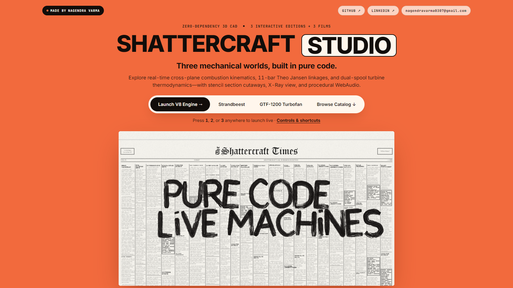
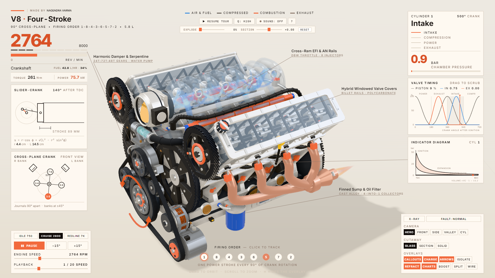
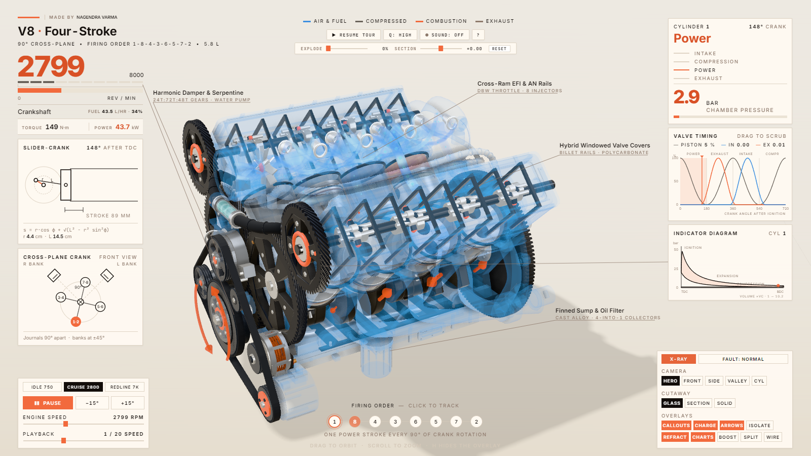
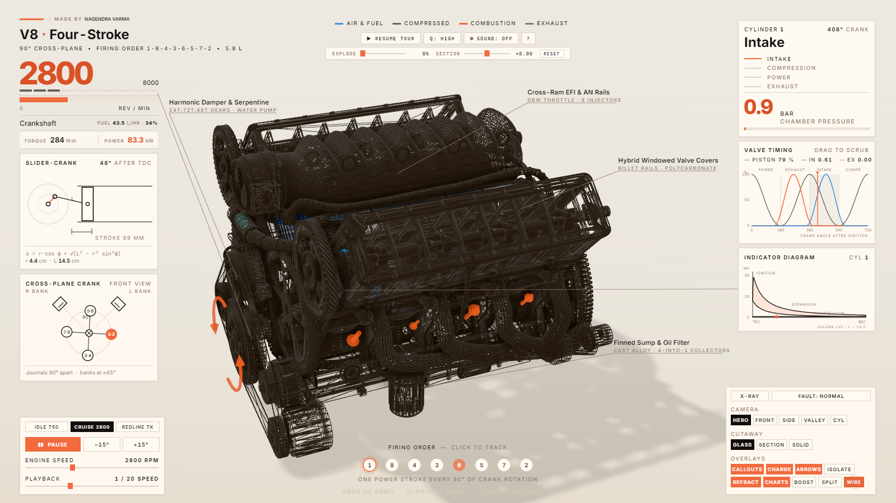
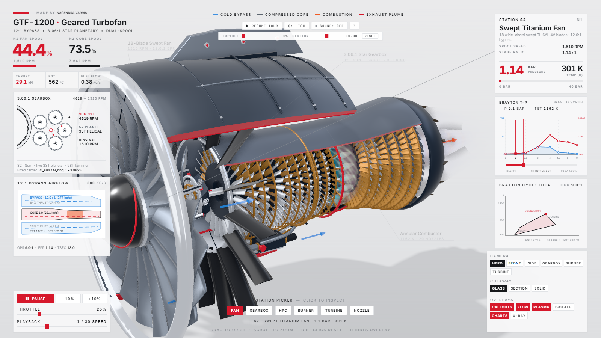
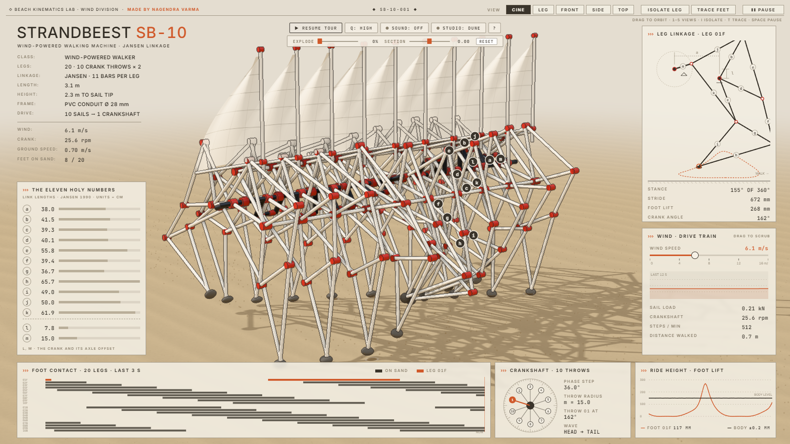
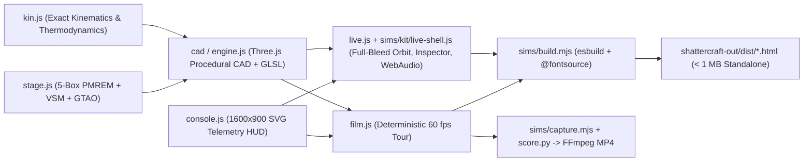

# Shattercraft Studio

**Three mechanical worlds, built in pure code.**  
Museum-grade procedural 3D CAD mechanical simulators compiled into self-contained, zero-network **< 1 MB standalone HTML bundles** with real-time kinematic & thermodynamic telemetry, interactive part inspection, axial/radial explode, stencil-capped section cutaways, cyan-cobalt X-Ray & CAD wireframe modes, procedural WebAudio, and deterministic 60 fps film export.



## Simulators

### 1. V8 · Four-Stroke Engine (Master Project)


| Cyan-Cobalt X-Ray Mode | CAD Wireframe Mode |
| :---: | :---: |
|  |  |

- **5.8 L 90° Cross-Plane V8** (`1-8-4-3-6-5-7-2` firing order) rendered on a calibrated `#f8f4ec → #ebe3d5` archival cream studio stage with soft VSM shadows, GTAO contact occlusion, and edge-to-edge viewport scaling.
- **Sculpted 8-Rib Induction Plenum & Sequential EFI**: Smoked mineral-sapphire polycarbonate plenum (or satin charcoal composite in `SOLID` mode) housing 8 CNC velocity-stack trumpets, flowing cyan-cobalt fuel-air vapor ribbons & atomized droplet beads, DBW throttle bore with brass butterfly plate, anodized fuel rails, and 8 sequential spray-cone injectors.
- **4-Into-1 Tubular Exhaust Merge Collectors**: Dual primary tube headers merging into collectors with O₂ sensor bosses, stroke-linked thermal exhaust glow, and combustion flame plumes.
- **Forged Billet Timing & Serpentine Accessory Chest**: Open-spoke `24T → 72T → 48T` helical timing gears plus an analytically wrapped multi-ribbed serpentine belt driving dark gunmetal-titanium harmonic damper, water pump & thermostat housing, power steering, spring-loaded belt tensioner, slotted copper-wound alternator, and lower A/C compressor clutch pulley.
- **Interactive Telemetry, Diagnostics & Cutaways**: Valve Timing chart scrubbing (`720°` cycle), P–V Indicator Diagram, Cross-Plane Crank phasing, Dyno presets (`IDLE 750`, `CRUISE 2800`, `REDLINE 7K`), **`+0.8 bar` BOOST**, `FAULT` diagnostics (`NORMAL / MISFIRE / KNOCK / OVERHEAT`), `GLASS` / `SECTION` / `SOLID` / `SPLIT` 50/50 cutaways, `X-RAY`, `WIRE` CAD wireframe (`W`), axial/radial explode, and procedural 8-cylinder combustion WebAudio.

### 2. GTF-1200 Geared Turbofan

- **12:1 Ultra-High Bypass Dual-Spool Engine**: `3.06:1` epicyclic fan-drive star gearbox, `18` wide-chord swept titanium fan blades, `3`-stage LPC, `6`-stage HPC, twin annular-sector swirl combustor with multi-frequency procedural GLSL plasma (`uTemp`, `uSwirl`, `uThrottle`), `2`-stage HPT, `4`-stage LPT, chevrons & shock-diamond exhaust plume, `X-RAY` / `SECTION` / `SOLID` cutaways, plus **Brayton T–P station scrubber**.

### 3. Strandbeest SB-10 Walker

- **11-Bar Theo Jansen Wind-Powered Walker**: `20` mirrored 11-bar Jansen legs across `10` crankshaft stations (`36°` phase wave) driven by `10` sails over simulated dune sand (`DUNE` / `SLATE` studio toggle), leg isolation, foot-locus loop tracing, wind-speed scrubber (`0–16 m/s`), `X-RAY` mode, and interactive kinematic linkage inspection.

## Quick Start

```bash
# 1. Install dependencies & headless Chromium (for verification tests and 60 fps capture)
npm install
npx playwright install chromium

# 2. Build all 7 self-contained HTML simulators (< 1 MB each) into shattercraft-out/dist/
npm run build

# 3. Launch the local Studio Hub & CORS-free server on http://127.0.0.1:8123
npm run studio

# 4. Run the automated Playwright + WebGL verification suite (HTTP + file://)
npm test
```

You can also open any generated file inside `shattercraft-out/dist/` (`studio.html`, `v8-live.html`, `strandbeest-live.html`, `turbofan-live.html`, `v8-film.html`, `turbofan-film.html`, `strandbeest-film.html`) directly via `file://` with **zero internet connection**.

## Architecture



## Controls & Keyboard Shortcuts

| Input | Action |
| --- | --- |
| **Drag** | Orbit 3D camera |
| **Scroll / Pinch** | Zoom in / out |
| **Double-click** | Reset camera & zoom |
| **Click any 3D part** | Pin CAD inspector card (material, subsystem, live telemetry) |
| **Space** | Pause / resume simulation |
| **1 – 5 / 6** | Switch camera presets |
| **← / →** | Step crank angle / wind speed / throttle |
| **W** | Toggle CAD Wireframe mode (V8) |
| **H** | Toggle telemetry HUD |
| **Q** | Cycle GPU quality tier (`HIGH` / `MED` / `LOW`) |
| **M** | Toggle procedural WebAudio synthesizer |
| **S** | Save clean PNG snapshot |
| **Esc / ?** | Clear selection / toggle shortcut guide |
| **1 / 2 / 3 (Studio Hub)** | Quick-launch V8, Strandbeest, or GTF-1200 simulator |

## Deterministic 60 fps Video & Master Audio Pipeline

```bash
# Render 26 s V8 tour audio (-14 LUFS) + 1600x900 60 fps video and mux
python run_sfx.py sims/v8-shared/score.py
node sims/capture.mjs v8-film --size 1600x900 --dpr 1.2 --out shattercraft-out/v8-silent.mp4
ffmpeg -y -i shattercraft-out/v8-silent.mp4 -i shattercraft-out/v8-score.wav -c:v copy -c:a aac -b:a 192k -shortest shattercraft-out/v8-master.mp4
```

## Author & Attribution

- **Made by Nagendra Varma** — *Shattercraft Studio Hub, Cross-Plane V8 Upgrade (`SOLID`/`GLASS`/`SECTION`/`SPLIT`/`X-RAY`/`WIRE`, Serpentine Accessory Chest & Dynamic Telemetry), GTF-1200 Geared Turbofan, Full-Bleed Live Shell, CAD Inspector & Verification Suite*
  - GitHub: [github.com/mvnrkvarma2009](https://github.com/mvnrkvarma2009)
  - LinkedIn: [Nagendra Varma Mudunuri](https://www.linkedin.com/in/nagendra-varma-mudunuri-4366103a5?utm_source=share_via&utm_content=profile&utm_medium=member_android)
  - Email: [nagendravarma0307@gmail.com](mailto:nagendravarma0307@gmail.com)
- Built upon the open-source mechanical simulator architecture (`MIT License`, see [LICENSE](LICENSE)).
